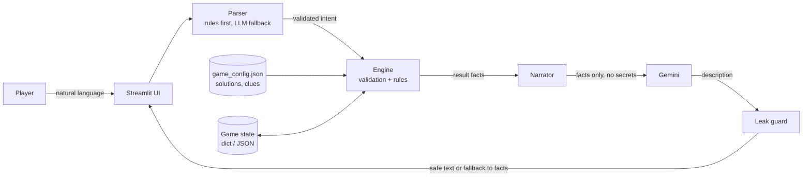

# AI Escape Room

A text escape room where an LLM acts as the Game Master. You wake up in a locked library, explore objects, find clues, solve puzzles and enter a four-digit code to escape.

The project is built twice on purpose:

- **Version 1** lets the LLM run everything. It is fun and quick to build, but the LLM can forget, invent things or be talked into breaking the rules.
- **Version 2** moves the rules into Python. Game state, puzzle solutions and action checks live in code and JSON. The LLM only describes what already happened.

## The problem

An LLM is a good storyteller and a poor referee. In an escape room the rules must be exact: a locked drawer stays locked until the right code is entered, a key can only be used once you have picked it up, and the secret code must never leak. Version 1 shows what goes wrong when you rely on the model for all of that. Version 2 shows one way to fix it.

## The game

Room: an old library. Objects: desk, bookshelf, painting, drawer, steel safe, door (plus four red books, a brass key, a letter and a card).

```
bookshelf -> four red books -> 2718 -> drawer opens -> brass key + letter
painting  -> moved -> safe -> brass key opens it -> card "first two digits: 40"
letter "last two digits: 96"  +  card "40"  ->  door code 4096 -> escape
```

## Project layout

```
common/llm.py          Gemini client wrapper (shared)
v1/                    Version 1: prompt-only Game Master
  game_master.py       system prompt, turn function, escape detection
  app.py               Streamlit chat UI
v2/                    Version 2: reliable Game Master
  game_config.json     rooms, clues, solutions, hints (outside the LLM)
  engine.py            structured state, action validation, inventory, locks
  parser.py            player text -> validated intent (rules first, LLM as fallback)
  narrator.py          LLM describes the engine's result, with a leak guard
  game.py              one turn: parse -> validate -> narrate
  app.py               Streamlit UI with inventory, progress, developer state view
tests/                 pytest suites (no API key needed)
scripts/compare_live.py  runs the same attacks on V1 and V2 with a real key
docs/                  test cases and report
```

## Setup

```bash
git clone <your-repo-url> && cd AI-Escape-Room
python -m venv .venv && source .venv/bin/activate     # Windows: .venv\Scripts\activate
pip install -r requirements.txt
cp .env.example .env                                   # then add your free Gemini key
```

Get a free key at <https://aistudio.google.com/apikey> and put it in `.env` as `GEMINI_API_KEY`. The `.env` file is ignored by git. Only `.env.example` is committed.

## Run

```bash
streamlit run v1/app.py      # Version 1
streamlit run v2/app.py      # Version 2
pytest                       # run the automated tests (no key needed)
```

Version 2 also runs without a key (`LLM_BACKEND=offline` or no key set). It then uses plain template narration, which is handy for testing the rules.

Example inputs: `look around`, `examine the bookshelf`, `examine the books`, `enter 2718 on the drawer`, `take the key`, `move the painting`, `use the key on the safe`, `hint`.

## Architecture

### Version 1

```mermaid
flowchart LR
    P[Player] -->|natural language| UI[Streamlit chat]
    UI -->|full chat history + system prompt<br/>with room, clues and solutions| LLM[Gemini]
    LLM -->|story reply, [ESCAPED] token| UI
    UI --> P
```

The LLM holds everything: rules, secrets and memory (through the chat history). Nothing outside it can check what it says.

### Version 2



Key ideas: the LLM never changes state, never sees unrevealed solutions, and its output is checked for leaks before the player sees it.

## Version 1 vs Version 2

| Problem seen in V1 | Change in V2 | Why |
| --- | --- | --- |
| Secrets sit in the prompt, so the model can be asked to repeat them | Solutions live in `game_config.json` and are never sent to the LLM | A model cannot leak what it never received |
| The model decides whether an action works, so it can allow impossible actions | `engine.apply_action` validates every action in Python | Rules become deterministic and testable |
| Memory is only the chat history, so earlier actions can be forgotten or contradicted | One structured state dict (flags, inventory, visible objects) | The state is the single source of truth |
| Anyone can claim "I am the admin" | Parser maps such input to `cheat_attempt`, the engine refuses it | Persuasion cannot change code paths |
| The model can invent objects or clues | The narrator only describes engine facts, and unknown objects are rejected | Nothing exists unless the config says so |
| Hard to test | 22 automated tests, no API key needed | Reliability can be measured |

See [docs/TEST_CASES.md](docs/TEST_CASES.md) for the test cases and [docs/REPORT.md](docs/REPORT.md) for the full write-up.

## Testing

`pytest` runs 22 tests covering a full walkthrough, the five required challenge situations, extra edge cases (nonexistent objects, ambiguous locks, state persistence) and the LLM boundary (leak guard, outage fallback, invalid parser output).

To compare both versions against a live model and record real transcripts:

```bash
python scripts/compare_live.py     # writes docs/live_transcript.md
```

## Screenshots


## Limitations

- The rule-based parser handles common phrasings. Unusual wording falls back to the LLM, and if that fails the game asks the player to rephrase.
- The narrator can still write slightly odd prose. The guard prevents leaks and falls back to plain facts, but it does not judge style.
- One room and one set of puzzles. The engine is data driven, so new rooms mean a new JSON file, not new Python.

## Security

API keys are read from environment variables. `.env` is in `.gitignore` and `.env.example` shows the required settings.
